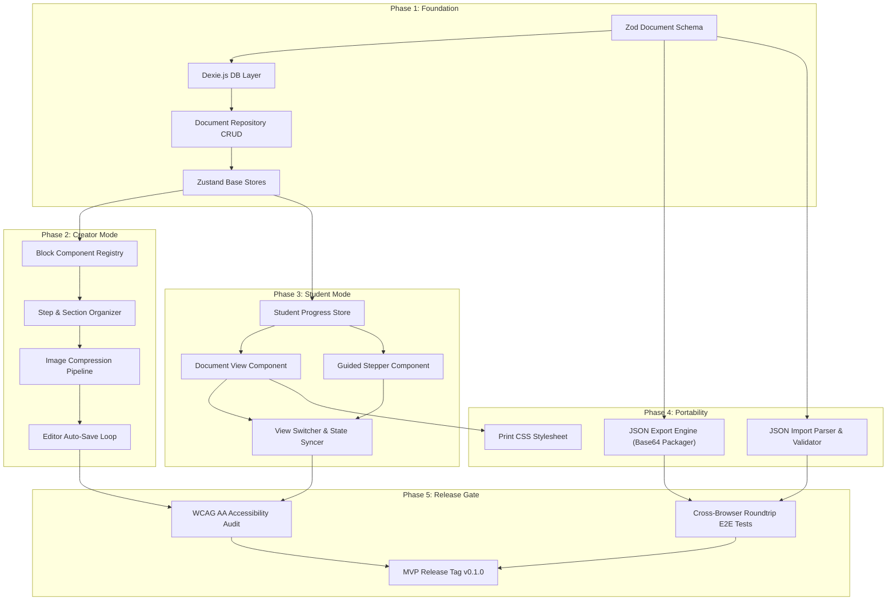

# OpenJobsheet MVP Roadmap & Implementation Plan

## Document Information
- **Product Name:** OpenJobsheet
- **Document Version:** 1.0.0
- **Planning Paradigm:** Milestone-Gated (No Arbitrary Calendar Deadlines)
- **Status:** Approved for Implementation Phase Kickoff

---

## 1. Development Phases & Milestones

The project execution follows a strictly ordered, dependency-driven progression. Each phase must satisfy its verification gate before work commences on subsequent phases.

```
+-----------------------------------------------------------------------------------+
|  Phase 0: Technical Specification & Design System (CURRENT STATE)                |
|  - Complete PRD, Design System tokens, Technical Architecture, Schema, ADRs       |
+-----------------------------------------------------------------------------------+
                                          |
                                          v
+-----------------------------------------------------------------------------------+
|  Phase 1: Core Engine, Schema Validation & Local Storage                          |
|  - Dexie.js database setup, Zod schema validator, AST CRUD operations             |
+-----------------------------------------------------------------------------------+
                                          |
                                          v
+-----------------------------------------------------------------------------------+
|  Phase 2: Creator Mode & Block Editor Canvas                                      |
|  - Block-based editing, step organizer, image paste/compression, local auto-save  |
+-----------------------------------------------------------------------------------+
                                          |
                                          v
+-----------------------------------------------------------------------------------+
|  Phase 3: Student Mode & Hybrid Viewing Engine                                    |
|  - Document View, Guided Step-by-Step View, Checklist Engine, State Synchronizer  |
+-----------------------------------------------------------------------------------+
                                          |
                                          v
+-----------------------------------------------------------------------------------+
|  Phase 4: Data Portability, Import / Export & Media Bundling                      |
|  - Standalone JSON packager, Schema migration parser, Print-to-PDF CSS            |
+-----------------------------------------------------------------------------------+
                                          |
                                          v
+-----------------------------------------------------------------------------------+
|  Phase 5: Offline Hardening, Accessibility & MVP Launch                           |
|  - Service Worker / PWA caching, Screen Wake Lock, WCAG AA compliance audit      |
+-----------------------------------------------------------------------------------+
                                          |
                                          v
+-----------------------------------------------------------------------------------+
|  Post-MVP Roadmap: Cloud Services & Multi-User Platform (Supabase)               |
|  - Cloud backup, Public sharing URLs, Classroom analytics, Teacher dashboard      |
+-----------------------------------------------------------------------------------+
```

---

## 2. Feature Priority Matrix (MoSCoW Framework)

### 2.1 Must Have (P0 — Non-negotiable MVP Gate)
- **F-M01:** Local-first document persistence via IndexedDB (zero account requirement).
- **F-M02:** Block-based editor supporting: Paragraph, Headings (H1–H3), Images/Screenshots, Code Snippets, Callouts (`danger`, `warning`, `tip`, `info`), and Checklists.
- **F-M03:** Step and section hierarchy builder with step numbering.
- **F-M04:** Continuous local auto-save with debounce (<500ms).
- **F-M05:** Student Mode Document View (full-text reading flow with Table of Contents).
- **F-M06:** Student Mode Guided View (single-step focus with Next/Previous navigation and progress bar).
- **F-M07:** Hybrid view synchronization preserving checklist completions and active step location.
- **F-M08:** Standalone JSON export and import with strict schema validation.
- **F-M09:** Local image paste and upload with client-side WebP compression.
- **F-M10:** Strict compliance with the Editorial Technical Workspace design system and dark mode tokens.

### 2.2 Should Have (P1 — Important for Ergonomics)
- **F-S01:** Screen Wake Lock API integration in Guided View to keep mobile screens active during workshop labs.
- **F-S02:** Print-optimized CSS stylesheet for clean "Save as PDF" browser exports.
- **F-S03:** Undo / Redo history stack in Creator Mode (`Ctrl+Z`, `Ctrl+Y`).
- **F-S04:** Estimated duration calculator summing individual step estimates.
- **F-S05:** Built-in starter templates (Networking Lab, Electronics Wiring, Software Setup).

### 2.3 Could Have (P2 — Desirable Enhancements)
- **F-C01:** Video embed block supporting local MP4 blobs and YouTube URLs.
- **F-C02:** QR Code generator for quick local JSON sharing between devices.
- **F-C03:** Full text search filter within long documents.
- **F-C04:** Keyboard shortcut cheatsheet overlay (`?`).

### 2.4 Won't Have for Initial MVP (Post-MVP Scope)
- **F-W01:** Cloud user accounts and login authentication.
- **F-W02:** Central PostgreSQL database sync.
- **F-W03:** Live multi-cursor collaborative editing.
- **F-W04:** Teacher grading dashboard and student submission collection.
- **F-W05:** Server-side PDF rendering or LaTeX typesetting pipeline.

---

## 3. Implementation Dependency Graph



---

## 4. Phase Breakdown & Acceptance Criteria

### Milestone 1: Core Foundation & Local Persistence
- **Deliverables:**
  - `src/core/schema`: Zod validation functions for `openjobsheet-document-schema` v1.0.0.
  - `src/lib/storage`: Dexie.js database instance with `jobsheets`, `media_assets`, `student_progress`, and `settings` tables.
  - Unit tests verifying serialization, deserialization, and schema rejection of malformed JSON.
- **Exit Criteria:** Automated test suite passes 100% of schema validation and storage CRUD tests.

### Milestone 2: Creator Mode (Authoring Workspace)
- **Deliverables:**
  - `/editor/[id]` route with top bar, outline drawer, and central block canvas.
  - Functional blocks: Heading (H1–H3), Paragraph, Code Block, Image Block, Callout Block, Checklist Block.
  - Drag-and-drop block and step reordering.
  - Image paste handler with client-side WebP compression.
  - Debounced auto-save writing to IndexedDB with visual status badge.
- **Exit Criteria:** An instructor can create a 4-step lab with 2 images and a code block, refresh the browser, and verify 0 data loss.

### Milestone 3: Student Mode & Hybrid Viewing Engine
- **Deliverables:**
  - `/view/[id]` route with view toggle (`Document` vs `Guided`).
  - Document View layout with sticky Table of Contents and responsive mobile drawer.
  - Guided View stepper with previous/next controls, progress bar, and touch targets (≥48px).
  - Synchronized checklist engine writing to `student_progress` table.
  - Scroll-anchored view switching logic.
- **Exit Criteria:** Ticking 3 items in Document View, toggling to Guided View, and verifying that the progress bar and checkboxes mirror the exact state without page reloads.

### Milestone 4: Portability & Export Tools
- **Deliverables:**
  - Export modal: Standalone `.json` packager (embeds media as base64) and lightweight `.json`.
  - Import modal: Drag-and-drop file upload with schema validation and conflict resolution (Overwrite vs Duplicate).
  - Print CSS stylesheet formatting clean physical lab handouts.
- **Exit Criteria:** Exporting a jobsheet from Chrome on Windows, importing the resulting `.json` file into Firefox on Android, and confirming 100% structural and visual fidelity.

### Milestone 5: Hardening & MVP Launch
- **Deliverables:**
  - Screen Wake Lock API integration.
  - Full keyboard navigation and ARIA live announcements for step transitions.
  - Automated Playwright E2E test suite covering the entire user journey.
  - Production static build optimization.
- **Exit Criteria:** Clean accessibility audit (zero WCAG AA violations) and Playwright test suite passing across Chromium, Firefox, and WebKit.

---

## 5. Definition of Done (DoD)

A feature is considered **Done** and ready for release only when:

1. **Design System Adherence:** Uses semantic design tokens from `DESIGN_SYSTEM.md`; zero arbitrary hex colors or prohibited anti-pattern styles.
2. **Type Safety:** 100% TypeScript strict mode; zero `any` types in domain code.
3. **Local-First Integrity:** Works completely offline without attempting unhandled network calls.
4. **Schema Compliance:** Any mutated document passes Zod validation against `openjobsheet-document-schema`.
5. **Ergonomic Quality:** Touch targets on mobile meet or exceed 48x48px; contrast ratios meet or exceed 4.5:1.
6. **Documentation & Tests:** Accompanied by unit tests for domain logic and updated documentation if APIs changed.
