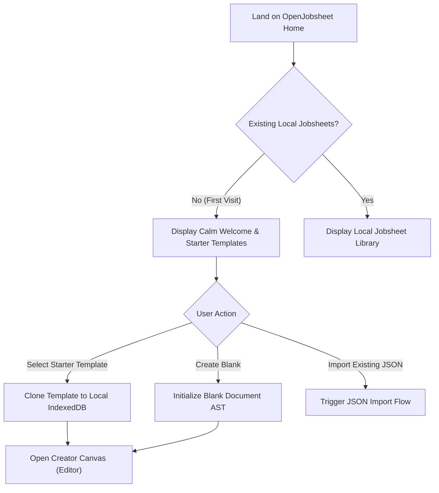
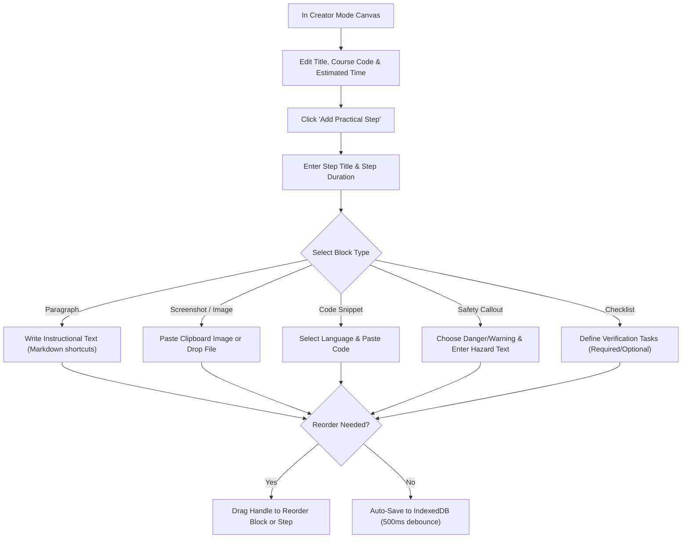
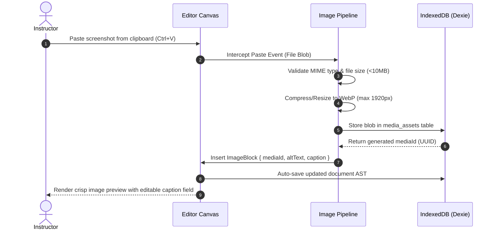
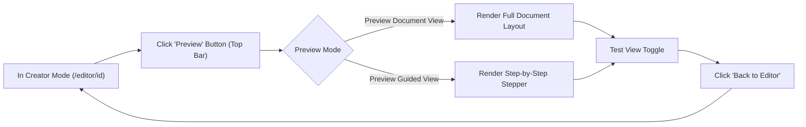
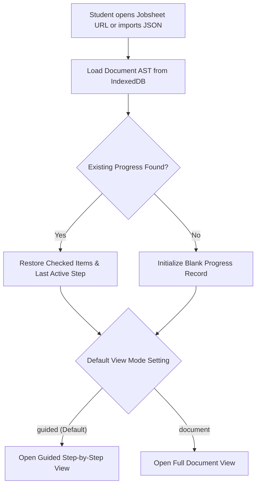
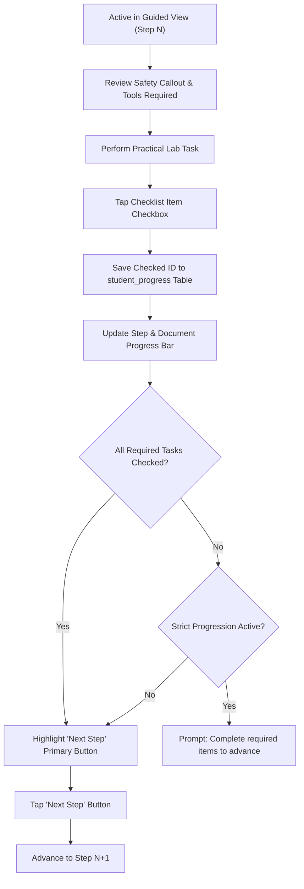
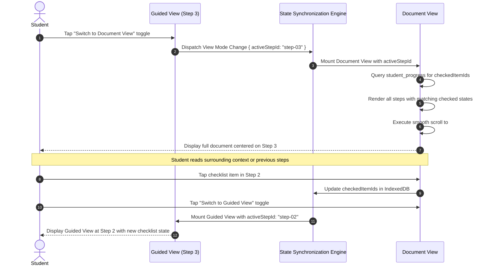
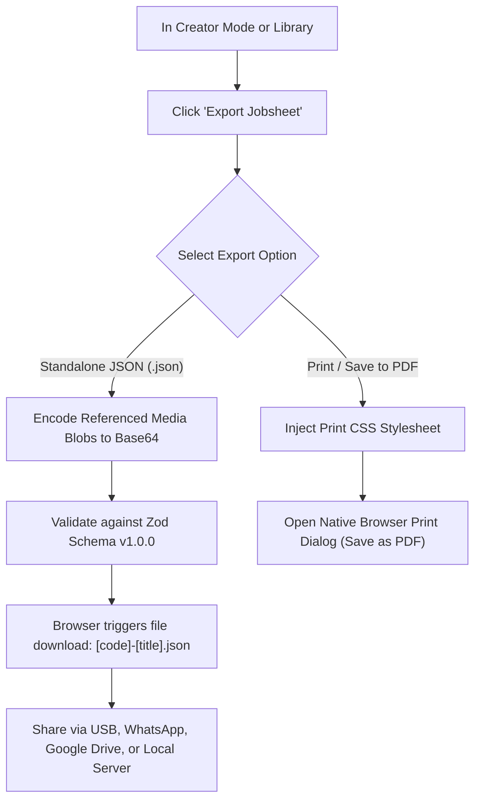
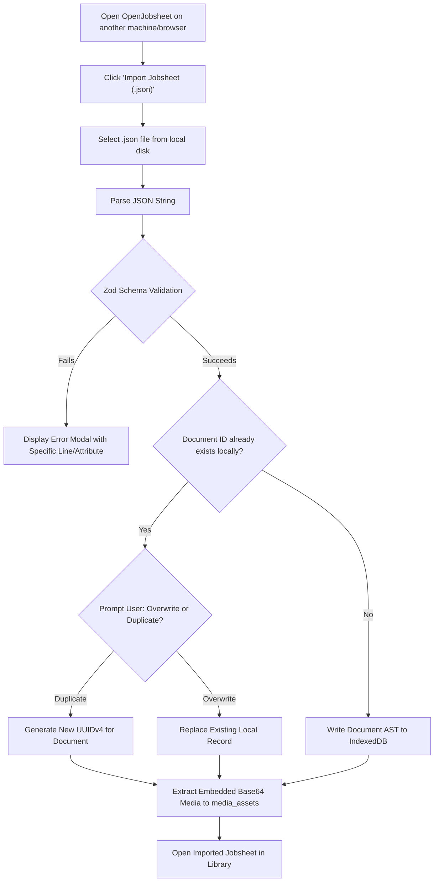

# User Flows & Interaction Journeys

## Document Information
- **Product Name:** OpenJobsheet
- **Document Version:** 1.0.0
- **Status:** Approved Behavioral Specification

---

## 1. Overview of Key User Journeys

OpenJobsheet facilitates distinct workflows across two primary user groups:
1. **Instructors / Creators:** Preparing, organizing, previewing, and distributing worksheets.
2. **Students / Practical Learners:** Reading instructions, navigating steps, verifying tasks, and tracking lab completion.

---

## 2. Creator Journeys

### 2.1 Journey 1: First-Time Visitor & Template Discovery

- **User Story:** As an instructor opening OpenJobsheet for the first time, I want to explore high-quality sample templates or immediately start a blank jobsheet without registering an account.
- **Key Interactions:**
  - Landing screen displays 3 default templates (Networking Lab, Electronics Wiring, Software Deployment).
  - Clicking "Use Template" clones the template into the browser's IndexedDB with a unique UUID.
  - URL routes to `/editor/[id]` with immediate auto-save active.

---

### 2.2 Journey 2: Authoring a Jobsheet & Managing Steps

- **User Story:** As an instructor, I want to write lab procedures using structured blocks and safety callouts so students can follow them without ambiguity.
- **Key Interactions:**
  - Pressing `/` or clicking the block inserter displays available content blocks.
  - Dragging a block reorders it within the step.
  - Dragging a step card in the sidebar outline reorders entire practical steps, automatically updating step numbers.

---

### 2.3 Journey 3: Adding Media & Code References

- **User Story:** As an instructor, I want to paste terminal output screenshots directly from my clipboard so I don't have to manually save and upload image files.
- **Key Interactions:**
  - Pasting an image automatically triggers client-side WebP compression.
  - The image immediately renders inline with a caption placeholder.
  - A small pill displays compressed file size (e.g., `142 KB WebP`).

---

### 2.4 Journey 4: Previewing the Student Experience

- **User Story:** As an instructor, I want to test how my jobsheet looks and behaves on mobile and desktop before sharing it with students.
- **Key Interactions:**
  - One-click transition into Student Mode with a persistent banner: *"Preview Mode — Changes here are read-only"*.
  - Instructors can test checking boxes and moving through steps without permanently saving student progress.

---

## 3. Student Journeys (Hybrid Execution)

### 3.1 Journey 5: Student Opening a Jobsheet

---

### 3.2 Journey 6: Guided Step-by-Step Execution

- **User Story:** As a student standing at a workshop bench with tools in hand, I want to see only the instructions and safety alerts for my current step, with large buttons to navigate when done.
- **Key Interactions:**
  - Tapping a checklist item instantly plays a subtle visual check animation and updates the progress indicator.
  - Screen wake-lock keeps the display illuminated while the student works with physical tools.
  - Bottom navigation bar is thumb-accessible on mobile devices.

---

### 3.3 Journey 7: Switching Views with State Preservation

- **User Story:** As a student in Guided View who wants to double-check an earlier wiring diagram, I want to switch to Document View without losing my current step or checked items.
- **Key Requirements:**
  - View toggling is instant (zero network roundtrips).
  - Scroll position accurately anchors to the active step.
  - Checklist states remain perfectly synchronized across both views.

---

## 4. Portability & Distribution Journeys

### 4.1 Journey 8: Exporting & Distributing a Jobsheet

---

### 4.2 Journey 9: Importing a Jobsheet

